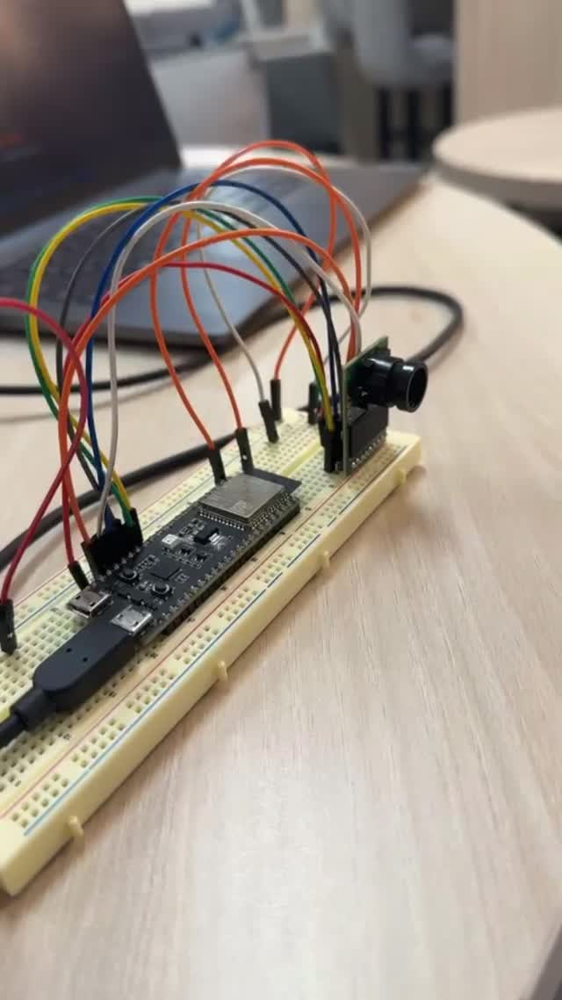
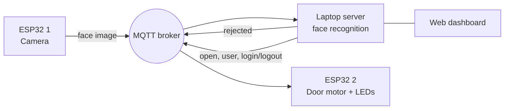

# Smart Office Face Authentication (IoT)

An IoT access-control system for a smart office. An ESP32 camera captures a face and sends it over MQTT to a laptop server. The server recognises the person with InsightFace (ArcFace), logs them in or out, and tells a second ESP32 to open the door and switch that person's office power (simulated with an LED). A web dashboard shows who is in the office and the login history.

Course project for COE 454 (Internet of Things) at KFUPM. Full write-up: [docs/Smart_Office_Report.pdf](docs/Smart_Office_Report.pdf)

<p align="center">
  
</p>

## How it works



1. **ESP32 1** takes a photo every 10 seconds and publishes it to the MQTT broker.
2. The **server** detects the face and compares it with the registered users.
3. If the person is recognised, the server logs them **in** (or **out** if they were already in), saves it to the history, and sends `open,<person_id>,login` or `open,<person_id>,logout`.
4. **ESP32 2** spins the door motor open and back, and turns the person's LED **on** at login and **off** at logout.
5. If the face is unknown, the server sends a reject message to ESP32 1.

**Tech stack:** Python, Flask, MQTT (Mosquitto + paho-mqtt), InsightFace/ArcFace, OpenCV, MicroPython on ESP32.

## Project structure

```
├── server/
│   ├── main.py              # server: MQTT, login/logout logic, history
│   ├── ai_model.py          # face recognition (InsightFace)
│   ├── dashboard.py         # Flask dashboard + JSON API
│   ├── templates/
│   │   └── dashboard.html   # dashboard page
│   └── people/              # registered users (not in the repo, see below)
├── esp32/
│   ├── esp32_camera.py      # ESP32 1: OV2640 camera, publishes images
│   └── esp32_door.py        # ESP32 2: door motor and user LEDs
├── docs/                    # report and images
└── requirements.txt
```

## Hardware

- **ESP32 1:** ESP32 board with an OV2640 camera module
- **ESP32 2:** ESP32 board with a DC motor on an H-bridge driver (the door) and one LED per user (the office power)
- A laptop on the same Wi-Fi network as both boards

Pin numbers are at the top of each ESP32 file.

## Setup

### 1. MQTT broker

Install [Mosquitto](https://mosquitto.org/) on the laptop. So the ESP32 boards can connect from the network, add these lines to `mosquitto.conf` and start it:

```
listener 1883
allow_anonymous true
```

### 2. Server

```bash
pip install -r requirements.txt
```

### 3. Register users

Face photos are private, so they are not in this repo. Add each user under `server/people/`:

```
server/people/Jane Doe/
├── info.json      {"person_id": "01", "name": "Jane Doe"}
├── img_001.jpg
└── ...            around 10 or more clear photos of the face
```

`person_id` must match one of the IDs in `LED_PINS` in `esp32_door.py`.

### 4. Run the server

```bash
cd server
python main.py --rebuild-db    # first time: builds the face database from people/
python main.py                 # after that
```

Open the dashboard at http://127.0.0.1:5055

### 5. ESP32 boards

1. Flash MicroPython on both boards and install `umqtt.simple`.
2. In both files, set `WIFI_SSID`, `WIFI_PASSWORD` and `MQTT_BROKER_IP` (the laptop's IP address, not `localhost`).
3. Upload `esp32_camera.py` to the camera board and `esp32_door.py` to the door board (for example with Thonny). Save each one as `main.py` on the board if you want it to start on boot.

## MQTT topics

| Topic | From → To | Message |
|---|---|---|
| `faceauth/esp32_1/image` | ESP32 1 → server | JPEG image bytes |
| `faceauth/esp32_1/reject` | server → ESP32 1 | `0` |
| `faceauth/esp32_2/door` | server → ESP32 2 | `open,<person_id>,login` or `open,<person_id>,logout` |

## Results

- End-to-end network latency (camera → server → door) was about **0.49 s**.
- Recognition confidence stayed below about 65 %, mainly because of the low image quality from the OV2640 camera.

The report has the full network and performance analysis.

## Future improvements

- Secure MQTT with a username, password and TLS
- Liveness detection, so a printed photo can't unlock the door
- A database instead of JSON files, and a page for registering new users
- A real relay for office power and a door sensor

## Authors

- **Thamer Alotaibi**: camera node, data preparation, face recognition, MQTT server
- **Abdulaziz Ashy**: door node, motor and LED control, dashboard
